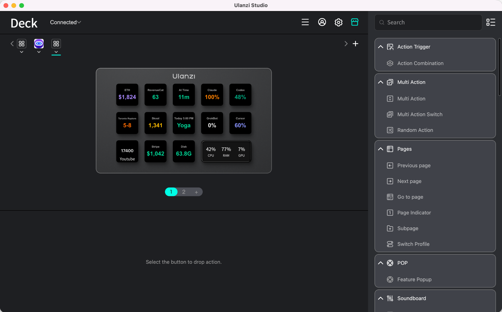
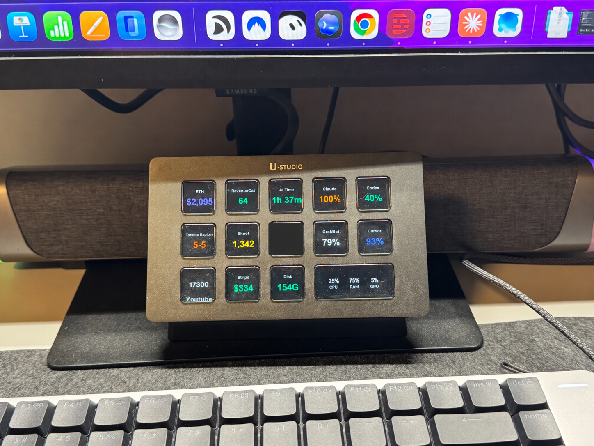

# Ulanzi AI Usage Kit

An experimental macOS utility for **Ulanzi Studio and the Ulanzi D200**. Put AI
quota readouts on physical keys, with optional local activity, calendar, and
business metrics. This is a personal project, not an official Ulanzi product.
It is **not compatible with Elgato Stream Deck**. Other Ulanzi models, Windows,
and Linux are not supported or tested.

Related project: Keith's [AI Usage / AttentionLedger](https://github.com/krumjahn/ai-usage).
That activity tracker is an optional, separate dependency; this repository does
not install it or change it.

## A look at the setup



Keith's customized profile in Ulanzi Studio. Values are a snapshot, not live data.
This screenshot includes optional integrations and separate YouTube/system-stat
buttons that are not bundled with this kit. The public starter profile is smaller;
see the dependencies below before adding more actions.



The physical D200 below the monitor. The calendar key is covered to hide the
meeting name and time.


The wider desk setup. The monitor display is covered to hide private chat,
project titles and desktop files; the D200 calendar key is also covered.

**Photo redactions:** The two photos are AI-assisted privacy edits of Keith's
supplied images, resized to 1448 × 1086. Opaque covers replace private content;
minor rendering differences outside those areas are possible. They illustrate
his setup, not a compatibility test of this public release. The unredacted photo
originals are not included. No private EXIF/location metadata is included;
AI-edit provenance metadata is retained.

## What is included

- A JavaScript plugin with editable source in `plugin/.../dist/` (no build step).
- A small D200 starter profile: Claude, Codex, Cursor, GrokBot, disk space, and
  AI Attention. Its device ID is blank. Add other actions yourself when ready.
- A prerequisite-checking installer, interactive credential setup, and an optional
  Swift calendar helper.
- Original geometric icons, offline tests, and a reviewed vendored `ws` dependency.

The sanitized profile and replacement inspector have not been tested on physical
hardware. If Ulanzi Studio does not list the unbound profile, create a new D200
profile and drag actions from **AI Usage** onto its keys.

## Requirements and installation

Use macOS 13 or later, Ulanzi Studio (manifest minimum 6.1), Python 3, and a
Node.js 18+ runtime. The installer accepts Node on PATH or Ulanzi Studio's bundled
runtime. Actual compatibility with each Studio/runtime version is unverified.
Open Ulanzi Studio once so its support folder exists, then quit it and its plugin
workers. Do not run the installer with sudo.

```sh
git clone https://github.com/krumjahn/ulanzi-ai-usage-kit.git
cd ulanzi-ai-usage-kit
bash install.sh --check
bash install.sh
```

`--check` validates prerequisites and source without installing. Installation
copies the plugin into `~/Library/Application Support/Ulanzi/UlanziDeck/Plugins/`
and adds a new profile under `ProfilesV2/`. An existing copy of this plugin is
moved to `~/.ulanzi/backups/`; its backup path is printed. The installer stages
files first and attempts rollback on failure. It refuses a running Studio
process and does not stop/restart apps, request permissions, build the calendar
helper, or change your selected profile. Open Studio yourself afterward.

For rollback: quit Studio, remove the newly installed plugin and the new profile
at the exact paths printed by the installer, then restore the previous plugin
from its printed backup path. Keep backups until you have verified your setup.
Credentials in `~/.ulanzi/` are separate and are not removed or overwritten by
installation.

## Data sources and optional setup

| Action | Dependency / setup |
| --- | --- |
| Claude, Codex, Cursor, GrokBot | Separately installed and authenticated **OpenUsage**. The adapter tries `http://127.0.0.1:6736/v1/usage`, `/v1/limits`, and `/Applications/OpenUsage.app/Contents/Helpers/openusage`. Provider availability and response schemas vary. |
| Claude token fallback | Reads today's usage fields from local `~/.claude/projects/**/*.jsonl` when OpenUsage has no token total. Quotas still depend on OpenUsage. |
| AI Attention | Separately installed AttentionLedger / AI Usage, its populated `~/Library/Application Support/com.rumjahn.attentionledger/activity.sqlite`, and `sqlite3`. Reports recorded activity time, not API billing or token usage. |
| Disk | Local `df` command; measures the volume containing your home folder. |
| MiniMax | Your own MiniMax key entered through setup. Uses the MiniMax coding-plan endpoint. It does not reuse your Claude key. |
| Gemini | Existing Gemini CLI OAuth files in `~/.gemini/`, plus your matching OAuth client ID/secret. Uses an internal Google quota endpoint that may change. Token refresh updates `~/.gemini/oauth_creds.json`. |
| Next Meeting | Optional Swift helper, EventKit, Calendar permission; Apple Events fallback may also require Automation permission and can be slow. |
| ETH | Public CoinGecko, Binance, and Coinbase endpoints; network access required. A fallback may use ETH/USDT as an approximation. |
| Raptors | ESPN's public endpoint. Select a Raptors display mode on **Grok Bot IT**. Pressing this action still opens Grok Bot. |
| Stripe | Restricted key with only the read permissions needed for balance, charges, refunds, and/or subscriptions. |
| RevenueCat | Secret API key scoped to your project and read-only metrics access; a public app key will not work. |
| Google Analytics | GA4 property ID and a service-account JSON with Viewer access to that property. The source also accepts manually provisioned OAuth credentials; no OAuth authorization wizard is included. |
| Social Followers | A Threads/Instagram handle and an installed Chromium-based browser for public-page scraping, or your own API token/user ID. Scraping and API access are best effort. |
| Skool | Set a community slug in the action's inspector; reads public page metadata, which may change. |
| Grok launcher | Separately installed Grok Bot handling `grokbot://` links. Supply your own agent ID. Leaves a draft by default; optional auto-send uses Accessibility automation. |

These dependencies are **not bundled**. `OFF`, `---`, `KEY?`, `PID?`, `HANDLE?`,
`N/A`, or `CAL?` generally mean missing setup, unavailable data, or a permission
problem. Installing this kit alone does not make the AI or Attention buttons work.

## Credentials

From the installed plugin directory (or the release plugin directory), run one
of these commands. Values are requested interactively, with secrets hidden:

```sh
bash tools/setup-keys.sh stripe
bash tools/setup-keys.sh revenuecat
bash tools/setup-keys.sh minimax
bash tools/setup-keys.sh gemini
bash tools/setup-keys.sh ga
bash tools/setup-keys.sh social
bash tools/setup-keys.sh social-handle
bash tools/setup-keys.sh show
```

Do not append secrets as arguments. `show` only reports configured section names
and file permissions. Setup performs no API calls and preserves unrelated JSON
sections; malformed existing JSON causes failure instead of being discarded.
Use `examples/stats.example.json` as a schema reference, not as working credentials.

Values are stored in **plaintext** in `~/.ulanzi/stats.json`, with mode **0600**
(owner read/write), inside a mode 0700 directory. This is **not encryption** or
Keychain storage: other processes running as your account can read it. Keep
credential files, service-account JSON, local caches, logs, and backups out of Git.
Use dedicated least-privilege, read-only keys wherever the provider supports them.
The GA service-account file must separately have owner-only permissions; grant
only Viewer access to the intended property. Rotate/revoke credentials in the
provider's console if exposed. Never paste them into an issue.

## Optional calendar helper

Install Apple's Xcode command line tools first (`xcode-select --install`). The
helper compiles Swift against Foundation, EventKit, and AppKit. From the plugin
folder, build and launch it explicitly:

```sh
bash tools/build-cal-helper.sh
open "$HOME/.ulanzi/calendar-helper/KeithAI Calendar Helper.app"
```

Allow Calendar access when macOS asks, then add **Next Meeting** in Studio. The
helper is locally built and ad-hoc signed, not notarized. Rebuilding or changing
its location may require granting access again. Calendar results, including
meeting titles, are cached locally in `~/.ulanzi/calendar-helper/last.json` and
`~/.ulanzi/calendar-cache.json`. The fallback talks to Calendar.app through Apple
Events. The experimental Google calendar path requires separately provisioned
Calendar read-only OAuth credentials in the `calendar` section of the config.

## Privacy and limitations

The plugin reads the configured local sources and sends credentials only to the
corresponding providers for authentication. OpenUsage is polled locally and may
itself contact providers. Public metric actions contact their listed providers.
The social scraper launches a separate temporary browser profile. No credential
files, calendars, activity databases, or real account identifiers are bundled.
Debug logging is off by default; `ULANZI_DEBUG=1` writes owner-readable
`~/.ulanzi/plugin.log`, which can contain private displayed values. Do not share it
without redaction.

Treat metrics as approximate readouts. API/schema changes, pagination limits,
cached values, and permissions affect accuracy. Stripe currently assumes
hundredths of a currency unit, caps list pagination, and may show gross charges
if refunds cannot be read. GA actions share a cache and the first active action's
period. Gemini quotas use an undocumented endpoint. This is not an accounting or
monitoring service.

## Development and support

```sh
python3 tools/validate.py
python3 -m unittest discover -s tests -v
node tests/offline.test.js
```

These checks use synthetic fixtures, temporary homes, and mocked process/network
calls. They do not launch Ulanzi, access real credentials, invoke paid APIs, or
request Accessibility/Calendar permissions. Hardware testing and live provider
verification were **not performed for this release**.

An optional GitHub Actions template is in
`examples/offline-validation.workflow.yml`. To enable automatic CI, copy it to
`.github/workflows/ci.yml` using GitHub credentials with workflow-write permission.
No active GitHub workflow is included in this initial publication.

Issues and small pull requests are welcome, but there is no support SLA or promise
of timely fixes. Include macOS/Studio/runtime versions and redacted symptoms.
Do not attach exported personal profiles or raw logs. The project is experimental
and may need adaptation for your setup.

MIT for the original project code; see [LICENSE](LICENSE) and
[THIRD_PARTY_NOTICES.md](THIRD_PARTY_NOTICES.md). The release excludes the original
unverified artwork/SDK libraries, personal notes, YouTube statistics integration,
private device/account IDs, and machine-specific app launchers. Service names
identify integrations and do not imply endorsement.
